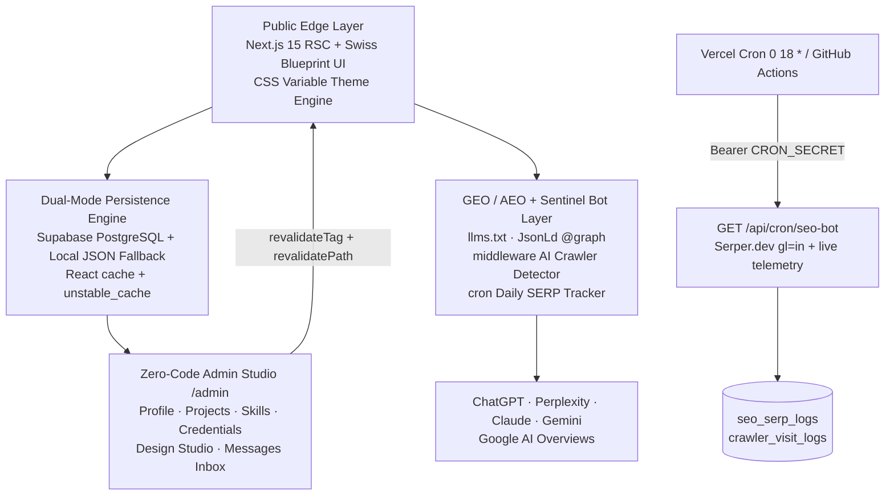

# ⚡ geetprince.me — Dynamic Next.js 15 Developer Portfolio, Headless CMS & AI Search (GEO/AEO) Engine

> **Official Dynamic Personal Portfolio & Engineering Architecture of [Prince Raj (`@Geet-Prince`)](https://geetprince.me)** — Full-Stack Software Engineer & B.Tech Computer Science and Engineering (Data Science) Undergraduate at **Noida Institute of Engineering and Technology (NIET), Greater Noida, India**.

[](https://geetprince.me)
[](https://progex.geetprince.me)
[](https://nextjs.org)
[](https://www.typescriptlang.org)
[](https://tailwindcss.com)
[](https://supabase.com)
[](https://geetprince.me)
[](https://geetprince.me/llms.txt)
[](https://aws.amazon.com)

## Why This Portfolio Stands Out

| Capability | Traditional Static Developer Portfolio | **`geetprince.me` (Dynamic Engineering Platform)** |
|---|---|---|
| Content Updates | Hardcoded JSX edits & git push | **Zero-code `/admin` CMS with instant on-demand ISR (<50ms cache purge)** |
| Visual Design | Generic template | **Swiss Architectural Blueprint Grid + live `/admin/design` Chameleon Theme Studio (4 Apple personas)** |
| Search Visibility | Basic meta tags | **Full-spectrum SEO + GEO (Generative Engine Optimization) + AEO (`FAQPage` + `Person` Schema.org `@graph`)** |
| AI Agent Readability | Unstructured DOM | **Native `/llms.txt` & `/llms-full.txt` Markdown endpoints for ChatGPT, Perplexity, Claude & Gemini** |
| Search Telemetry | Blind guessing | **Built-in "Geet-Sentinel" daily Google SERP rank tracker & real-time AI crawler trap (`/admin/seo-bot`)** |
| Interactive UX | Static cards | **`⌘K` Apple Spotlight Command Palette, Executive vs. Architecture X-Ray view & Web Audio API acoustic guitar synth** |

## System Architecture



**Theme personas:** `cupertino-light` · `sequoia-dark` · `editorial-paper` · `nordic-slate` — server-injected CSS variables, zero flash, zero theme JS.

## The 5 Core Engineering Pillars

### 1. Swiss Architectural Grid & Apple Tactile UX
Exposed `1px` hairline rails run Navbar → Footer with `+` intersection crosshairs and monospace section coordinates (`[ 01 // IDENTITY ]`). The `⌘K` Command Palette jumps anywhere instantly, the Executive vs. Architecture X-Ray toggle flips project cards into system schematics (SVG node pipelines generated from each project's real `tech_stack`, with animated data-packet dots), and a hidden tile synthesizes warm acoustic guitar chords via the Web Audio API — zero audio files.

### 2. Dynamic No-Code Chameleon Design Studio (`/admin/design`)
Switch 4 curated palettes, 3 hero layouts (`apple-centered`, `split-executive`, `bento-first`), card radius (`8px`–`32px`), glass blur, accent color, drag-free section ordering with per-section visibility, and recruiter links (`/?for=Company`) with custom welcome messages — every change re-themes the live site with no code and no rebuild.

### 3. GEO, AEO & `llms.txt` AI Search Architecture
Machine-verifiable entity triples saturate every heading (`Prince Raj` · `Geet-Prince` · `NIET Prince Raj`), project pages carry `<dl>` Technical Specification blocks for RAG extraction, and a unified Schema.org `@graph` (`Person` → NIET `alumniOf` → `hasCredential` → `sameAs` → `FAQPage` → `SoftwareApplication` list) mirrors the editable AEO dossier. AI agents get first-class Markdown at `/llms.txt`, `/llms-full.txt`, and per-project `/projects/[slug]/llms.txt`, all discoverable via `<link rel="alternate" type="text/markdown">`.

### 4. "Geet-Sentinel" Daily SERP & Crawler Bot (`/admin/seo-bot`)
A daily `0 18 * * *` UTC cron (Vercel + GitHub Actions dual-redundancy) checks Google India rankings via Serper.dev (`gl=in`) for `"geetprince"`, `"Prince Raj"`, `"NIET Prince Raj"` and custom keywords — tracking `geetprince.me`, `progex.geetprince.me`, and GitHub rank per query, with live endpoint telemetry (HTTP status + latency, GitHub authority stats, IndexNow pings). The middleware trap fingerprints `Googlebot`, `GPTBot`, `ClaudeBot`, `PerplexityBot`, `Applebot` and more, logging every crawl fire-and-forget. Without an API key the bot runs labeled simulated diagnostics; paste a Serper key in `/admin/seo-bot` for live data with no restart.

### 5. 100/100 Google Lighthouse Performance Engineering
Single-pass parallel data fetching wrapped in React `cache()` + `unstable_cache` (`portfolio-data` tag, 1500ms Supabase timeout with instant local fallback), zero-CLS locked fonts/layout, server-injected theme variables (no theme JS), lazy command palette island, `optimizePackageImports`, and Turbopack dev — engineered for sub-50ms navigations.

## Featured Projects by Prince Raj (`@Geet-Prince`)

| Project | What it is |
|---|---|
| **[Progex (`progex.geetprince.me`)](https://progex.geetprince.me)** | Competitive programming analytics platform (Python, Flask, Firebase, Tailwind CSS, UptimeRobot) tracking 270+ DSA problems, LeetCode streaks, and peer leaderboards |
| **Eventify** | Full-stack institutional event management platform with cryptographic QR-code gate authentication & RBAC |
| **Verse** | Real-time synchronized social music streaming rooms (<100ms sync latency with React, Kotlin & Firebase) |
| **Accenture Coding Practice Sandbox** | Automated offline coding judge & placement curriculum with PowerShell test runners and VS Code tasks |
| **Retro & Carvaan** | Collaborative full-stack web engineering projects |

Full case studies with architecture X-Rays: [geetprince.me/projects](https://geetprince.me/projects)

## Directory Structure

```
src/
├── app/
│   ├── (public)/page.tsx            # Homepage (SSR, section ordering engine)
│   ├── (public)/projects/          # Archive + [slug] case studies
│   ├── projects/[slug]/llms.txt/   # Per-project AI Markdown endpoint
│   ├── admin/                      # login, overview, projects, skills,
│   │                               # experience, faqs, messages, design, seo-bot
│   ├── api/contact                 # Contact form (rate-limit + honeypot)
│   ├── api/crawler-log             # Bot telemetry ingestion
│   ├── api/cron/seo-bot            # Daily SERP + telemetry scan
│   ├── api/revalidate              # On-demand ISR purge
│   ├── llms.txt/ llms-full.txt/    # AI agent knowledge endpoints
│   ├── layout.tsx / globals.css     # Fonts, theme injection, design system
│   ├── opengraph-image.tsx / robots.ts / sitemap.ts
│   └── [keyFile]/route.ts          # IndexNow key verifier
├── components/
│   ├── home/                       # Hero, Bento, FeaturedProjects, SkillsMatrix,
│   │                               # Timeline, AeoEntityDossier, Contact, HeroDock…
│   ├── layout/                     # Navbar, Footer, CommandPalette, PaletteIsland
│   ├── admin/                      # ProfileForm, DesignStudio, FaqManager,
│   │                               # ScanButton, BotConfigPanel, …
│   └── seo/JsonLd.tsx              # Unified Schema.org @graph
├── lib/
│   ├── data-fetcher.ts             # Cached bundle (React cache + unstable_cache)
│   ├── local-store.ts              # Dual-mode JSON fallback (data/ dir)
│   ├── seo-bot.ts                  # Sentinel core: scan, telemetry, bot detect
│   ├── themes.ts                   # 4 Apple theme token presets
│   └── supabase/                   # browser/server/service clients + actions
├── middleware.ts                   # Admin guard + AI crawler trap
supabase/
├── schema.sql                      # 11 tables + RLS policies (run once)
└── reset-schema.sql               # Full wipe + rebuild script
.github/workflows/daily-seo-bot.yml # Backup daily cron (18:00 UTC)
vercel.json                         # Vercel cron (0 18 * * *)
```

## Getting Started (60-Second Zero-Config Quickstart)

No database needed — the built-in dual-mode store serves seed content instantly:

```bash
git clone https://github.com/Geet-Prince/dynamic-portfolio.git
cd dynamic-portfolio
npm install
npm run dev -- --turbopack
```

Open [http://localhost:3000](http://localhost:3000) — the full site works 100% out of the box. Admin login at `/admin/login` (default password `admin123`, change `ADMIN_PASSWORD` immediately). Edits persist to `data/portfolio-store.json` (gitignored) until Supabase is connected.

```bash
npm run build   # production build (Turbopack not used for builds)
npm run start   # serve production
npm run lint    # eslint
```

## Environment Variables & Supabase Production Setup

| Variable | Required | Purpose |
|---|---|---|
| `NEXT_PUBLIC_SUPABASE_URL` | Yes (prod) | Supabase project URL |
| `NEXT_PUBLIC_SUPABASE_ANON_KEY` | Yes (prod) | Public anon key (RLS-protected reads) |
| `SUPABASE_SERVICE_ROLE_KEY` | Yes (prod) | Server-only writes bypassing RLS — never expose client-side |
| `ADMIN_PASSWORD` | Yes | `/admin` login passphrase |
| `ADMIN_SESSION_SECRET` | Yes | Signs admin session cookies |
| `NEXT_PUBLIC_SITE_URL` | Yes | Canonical URL (`https://geetprince.me`) |
| `REVALIDATE_SECRET` | Yes | Guards `/api/revalidate` |
| `SERPER_API_KEY` | No | Live Google India SERP data (or paste in `/admin/seo-bot` vault — no restart needed) |
| `GOOGLE_CUSTOM_SEARCH_KEY` / `GOOGLE_SEARCH_ENGINE_ID` | No | Fallback SERP provider |
| `CRON_SECRET` | Yes (prod cron) | Bearer token for `/api/cron/seo-bot` (Vercel + GitHub Actions) |

**Supabase setup:** create a project → SQL Editor → paste `supabase/schema.sql` → run once → copy the three keys above into `.env.local` → restart. (Starting over? Run `supabase/reset-schema.sql` instead — it wipes and rebuilds all 11 tables.)

## API & Machine-Readable Endpoints

| Endpoint | Description |
|---|---|
| `GET /` | Server-rendered portfolio homepage |
| `GET /projects` & `GET /projects/[slug]` | Filterable archive & deep case studies with X-Ray specs |
| `GET /llms.txt` | Curated AI agent index (llmstxt.org standard) |
| `GET /llms-full.txt` | Unabridged Markdown knowledge base for RAG & LLMs |
| `GET /projects/[slug]/llms.txt` | Per-project Markdown specification |
| `GET /sitemap.xml` & `GET /robots.txt` | Search & AI crawler directives (GPTBot, ClaudeBot, PerplexityBot allowed) |
| `GET /api/cron/seo-bot` | Daily SERP + endpoint telemetry scan (Bearer `CRON_SECRET` or `?secret=`) |
| `POST /api/crawler-log` | Async AI/search bot telemetry ingestion (fire-and-forget) |

## About the Author — Prince Raj (`Geet-Prince`)

> **Prince Raj** (developer handle **`Geet-Prince`**) is a Full-Stack Software Engineer and Data Science specialist — an **AWS Certified Cloud Practitioner** pursuing a **B.Tech in Computer Science and Engineering (Data Science)** at the **Noida Institute of Engineering and Technology (NIET), Greater Noida, Uttar Pradesh, India**.

- **Portfolio:** [https://geetprince.me](https://geetprince.me)
- **Progex Live App:** [https://progex.geetprince.me](https://progex.geetprince.me)
- **GitHub:** [https://github.com/Geet-Prince](https://github.com/Geet-Prince)
- **Institution:** B.Tech CSE (Data Science), NIET Greater Noida
- **Certification:** AWS Certified Cloud Practitioner
- **Competitive Programming:** 270+ DSA problems (LeetCode, GeeksforGeeks, CodeChef)

## Keywords & Search Index

<details>
<summary>🔍 Repository Search Tags & Ecosystem Index</summary>

**Portfolio:** developer-portfolio · portfolio-website · personal-portfolio · nextjs-portfolio · nextjs-15-portfolio · react-portfolio · software-engineer-portfolio · data-science-portfolio · headless-cms-portfolio · dynamic-portfolio · apple-style-portfolio · apple-inspired-portfolio · zero-config-portfolio · full-stack-portfolio

**AI Search:** llms-txt · generative-engine-optimization · geo · answer-engine-optimization · aeo · ai-search-optimization · rag-ready · json-ld · schema-org · serp-tracker · ai-crawler · chatbot-readable

**Stack:** nextjs-15-app-router · react-19 · typescript-strict · tailwindcss · supabase-postgres · supabase-nextjs-template · framer-motion · zod-validation · turbopack · vercel-cron · github-actions-cron · indexnow

**Entity:** prince-raj · prince-raj-niet · geetprince · geet-prince · geetprince-me · niet-greater-noida · noida-institute-of-engineering-and-technology · progex · progex-geetprince-me · accenture-coding-sandbox · eventify · verse-app · retro-carvaan · aws-certified-cloud-practitioner · 270-dsa · leetcode-portfolio

</details>
